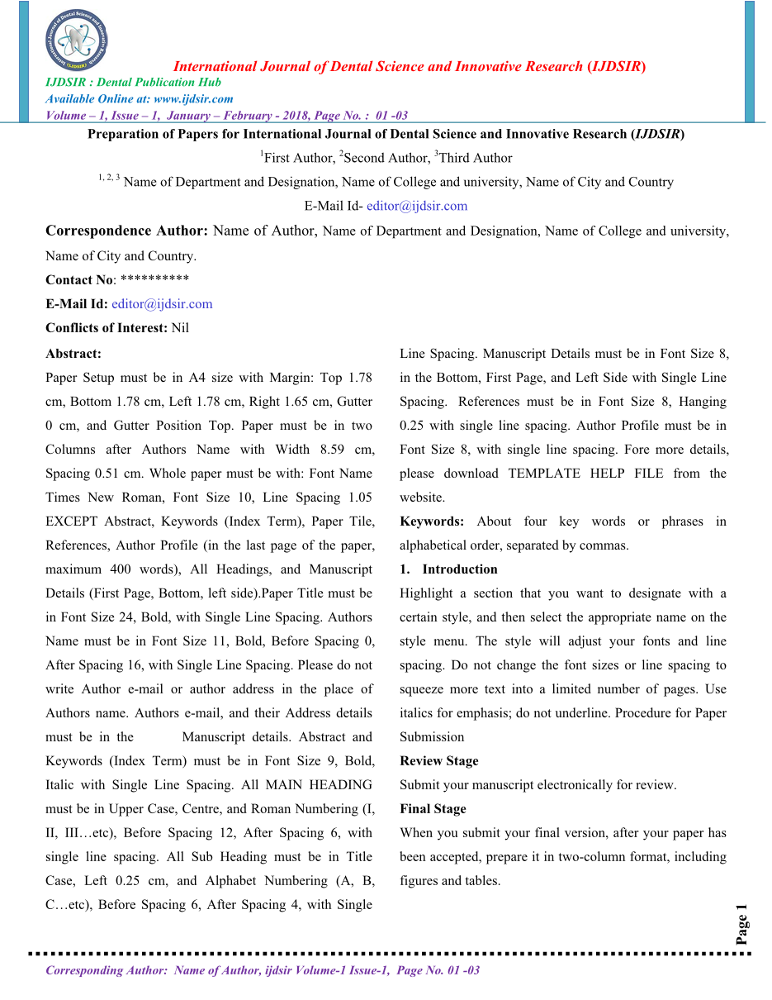
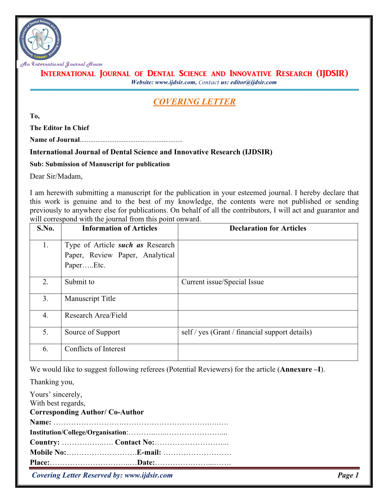

# IJDSIR Manuscript Formatter

Typst templates that reproduce the layout of the
**International Journal of Dental Science and Innovative Research (IJDSIR)**:
the manuscript and the covering letter, matched against the journal's own PDFs.
There is also a Claude Code workflow that takes a paper written in Word (`.docx`) and returns it in
journal format, keeping every word of the content as written.

<p align="center">
  
  &nbsp;
  
</p>

## Features

- **Matched to the journal's PDFs.** Page size, margins, two-column layout, 1.5 line spacing,
  masthead, footers and page numbers were measured from the journal's PDFs. In the sample,
  text positions agree within about 0.25 pt.
- **Word-compatible line breaking.** Hyphenation, kerning and ligatures are switched off and lines
  are filled greedily, so lines break where Microsoft Word breaks them.
- **Manuscript template.** Title block, authors with numbered affiliations, correspondence details,
  abstract and keywords, numbered sections, figures, tables and references.
- **Covering letter template.** Includes the article declaration table and the Annexure-I reviewer
  list. Any field left empty prints the journal's dotted blank.
- **Word-to-journal workflow.** Give Claude Code a `.docx` and it produces the formatted paper as
  `.docx` and `.pdf`, with a word-by-word check that nothing was changed
  (see [`CLAUDE.md`](CLAUDE.md)).

## Requirements

- [Typst](https://typst.app) 0.14 or newer
- [pandoc](https://pandoc.org), used to read `.docx` input
- Times New Roman (comes with macOS and Windows)

```sh
brew install typst pandoc   # macOS
```

## Quick start

```sh
git clone https://github.com/adityak74/ijdsir-format.git
cd ijdsir-format/typst

typst compile --root .. manuscript.typ                              # → manuscript.pdf
typst compile --root .. --font-path ../assets covering-letter.typ   # → covering-letter.pdf
```

`--font-path ../assets` is needed for the decorative fonts in the covering-letter header.

## Formatting a paper

### Using Claude Code (no coding needed)

Open [Claude Code](https://claude.com/claude-code) in this folder and ask:

> Format this paper for IJDSIR: `/path/to/paper.docx`

Claude follows [`CLAUDE.md`](CLAUDE.md). It fills the journal template with the paper's content
exactly as written, asks for any required detail the paper doesn't include (such as a phone number
or keywords), checks the output word by word against the input, and writes the results to
`papers/<name>/`:

| File | Description |
| --- | --- |
| `paper.docx` | The paper in the journal's Word template |
| `paper.pdf` | Print preview from the Typst template |
| `covering-letter.pdf` | Covering letter (on request) |

### By hand

Copy `typst/manuscript.typ`, change the import path, and replace the sample fields and text:

```typst
#import "../../typst/ijdsir.typ": manuscript

#show: manuscript.with(
  title: [Paper title],
  authors: ((name: "A. Author", aff: 1), (name: "B. Author", aff: 2)),
  affiliations: ("Department, College, City, Country", "Department, College, City, Country"),
  email: "author@example.com",
  corresponding: (name: "A. Author", address: "…", phone: "…", email: "…"),
  conflicts: "Nil",
  keywords: ("Keyword one", "Keyword two"),
  abstract: [Abstract text.],
)

= Introduction
Body text…
```

## Repository layout

```
.
├── CLAUDE.md                     # Workflow instructions for Claude Code
├── typst/
│   ├── ijdsir.typ                # Templates: manuscript(), covering-letter()
│   ├── manuscript.typ            # Sample manuscript (journal's sample text)
│   └── covering-letter.typ       # Sample covering letter (blank form)
├── package/                      # Typst Universe package (molar-ijdsir)
├── assets/                       # Covering-letter header fonts and images
├── docs/                         # README preview images
└── *.pdf, *.doc, *.docx          # Original journal templates and author instructions
```

## Known limitations

- **Page 1 holds one line fewer than the journal's PDF.** Typst can't give page 1 a different
  bottom margin from later pages, so it uses the later pages' margin.
- **The page number on pages 2 onward uses Times New Roman.** The journal uses Cambria; it is used
  automatically if installed.

## Typst Universe package

`package/` is the same template packaged as
[`molar-ijdsir`](https://typst.app/universe/package/molar-ijdsir) for Typst Universe, without the
journal's logo, fonts or files:

```sh
typst init @preview/molar-ijdsir:0.1.0
```

## License

The template code (`typst/`, `package/`, `CLAUDE.md`, `docs/`) is released under the [MIT License](LICENSE).
The journal's files in the repository root and the fonts and images in `assets/` are **not**
covered by it. They belong to their respective owners.

## Disclaimer

This project is independent and is not affiliated with or endorsed by IJDSIR. The journal's
templates, author instructions, logo and the decorative font pieces extracted from its PDFs
belong to their respective owners and are included only so the output can be compared with
the originals. Always check the journal's current author instructions before you submit.
